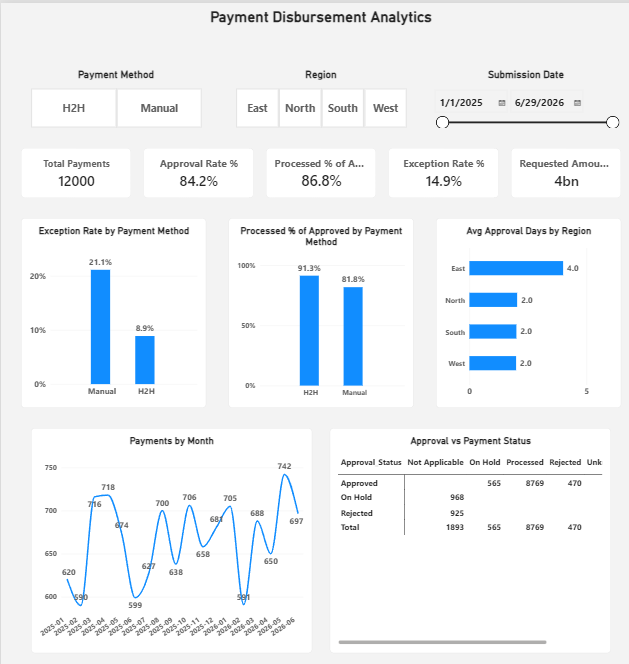

# Payment Disbursement Analytics (SQL + Python + Power BI)

An end-to-end analytics project on **synthetic** payment-request data, modelled on how a payment-disbursement team's MIS looks: request submitted -> approved (or put on hold / rejected) -> processed (H2H or Manual).

> **Data note:** All data is generated with Python (Faker + random). No real company, customer or employee data is used. The patterns in the data (for example Manual payments having more exceptions) were designed by me, so the project is about building the pipeline and analysis, not about real-world findings.

## What it does
1. `generate_data.py` creates ~12,000 payment requests (Jan 2025 - Jun 2026) with some deliberate mess: duplicate rows and missing Payment_Status.
2. `clean_and_analyze.py` cleans the data with pandas (duplicates, date conversion, missing values, invalid dates, INR conversion, Approval_Days and Buffer_Days), loads it into SQLite, runs 10 SQL queries and exports the results to `output/`.
3. `Payment_Disbursement_Dashboard.pbix` reads `clean_payment_data.csv` and shows the KPIs and charts in Power BI.

## Tools
Python (pandas, numpy, Faker, sqlite3), SQL (SQLite - GROUP BY, CASE WHEN, subqueries, window functions LAG and RANK), Power BI (Power Query, DAX measures, slicers).

## Folder structure
"""generate_data.py          -> creates raw_payment_data.csv
clean_and_analyze.py      -> cleans data, builds payments.db, runs queries
queries.sql               -> the 10 SQL queries with comments
raw_payment_data.csv      -> raw synthetic data (with duplicates / blanks)
clean_payment_data.csv    -> cleaned data used by Power BI
output/                   -> query results as CSV
Payment_Disbursement_Dashboard.pbix
dashboard.png"""

## How to run
1. Install the required libraries
pip install pandas numpy faker
2. Create the fake data (includes some deliberate duplicates and blanks)
python generate_data.py
creates raw_payment_data.csv
3. Clean the data and run the SQL queries
python clean_and_analyze.py
creates clean_payment_data.csv, payment.db and the ouput folder

Then open the `.pbix` in Power BI Desktop and click Refresh (update the CSV path if needed).

## Dashboard

KPIs: Total Payments, Requested Amount (INR), Approval Rate %, Processed % of Approved, Exception Rate %, Avg Approval Days.

## Checks
The same KPIs were calculated in SQL and in Power BI (DAX) and the numbers match.

## Limitations / next steps
- Currently run manually; planned: monthly input files plus a scheduled run.
- Exception_Type is treated as a separate log joined by Request_ID.
