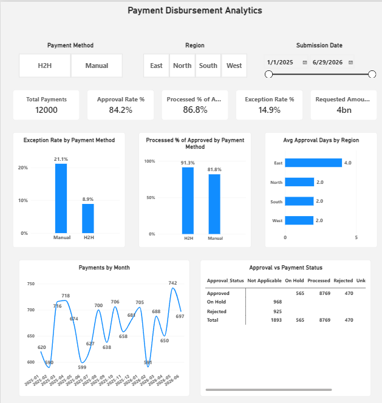

# Payment Disbursement Analytics (SQL + Python + Power BI)

An end-to-end analytics project on **synthetic** payment-request data, modelled on how a payment-disbursement team's MIS looks: request submitted -> approved (or put on hold / rejected) -> processed (H2H or Manual).

> **Data note:** All data is generated with Python (Faker + random). No real company, customer or employee data is used. The patterns in the data (for example Manual payments having more exceptions) were designed by me, so the project is about building the pipeline and analysis, not about real-world findings.

## What it does
1. `generate_data.py` creates ~12,000 payment requests (Jan 2025 - Jun 2026) and saves them as one raw file per month in `raw_data/`, with some deliberate mess: duplicate rows and missing Payment_Status.
2. `clean_and_analyze.py` reads all monthly files, cleans the data with pandas (duplicates, date conversion, missing values, invalid dates, INR conversion, Approval_Days and Buffer_Days), loads it into SQLite, runs 10 SQL queries and saves the results to `output/`.
3. `Payment_Disbursement_Dashboard.pbix` reads `clean_payment_data.csv` and shows the KPIs and charts in Power BI.
4. `generate_new_month.py` simulates a new monthly file arriving (for example `raw_2026_07.csv`). `run_pipeline.bat` runs the new-month step and the cleaning step together, and is scheduled with Windows Task Scheduler.

## Tools
Python (pandas, numpy, Faker, sqlite3), SQL (SQLite - GROUP BY, CASE WHEN, subqueries, window functions LAG and RANK), Power BI (Power Query, DAX measures, slicers), Windows Task Scheduler.

## Folder structure
generate_data.py          -> creates the monthly raw files in raw_data/
generate_new_month.py     -> simulates the next month's raw file
clean_and_analyze.py      -> reads all monthly files, cleans data, builds payments.db, runs queries
run_pipeline.bat          -> runs the new-month step and the cleaning step (used by Task Scheduler)
queries.sql               -> the 10 SQL queries with comments
raw_data/                 -> one raw file per month (with duplicates / blanks)
clean_payment_data.csv    -> cleaned data used by Power BI
output/                   -> query results as CSV
Payment_Disbursement_Dashboard.pbix
dashboard.png             -> screenshot of the dashboard

## How to run
1. Install the required libraries (sqlite3 comes built in with Python):
   `pip install pandas numpy faker`
2. Create the fake monthly data:
   `python generate_data.py`
3. Clean the data and run the SQL queries:
   `python clean_and_analyze.py`
   This creates `clean_payment_data.csv`, `payments.db` and the `output/` folder.
4. Open `Payment_Disbursement_Dashboard.pbix` in Power BI Desktop and click Refresh (update the CSV path if needed).

## Monthly automation
`python generate_new_month.py` adds the next month's file to `raw_data/`, and running `clean_and_analyze.py` again picks it up. `run_pipeline.bat` does both steps and was scheduled monthly with Windows Task Scheduler. After a run, click Refresh in Power BI to see the new month (clear the date slicer if an old range is selected).

## Dashboard

KPIs: Total Payments, Requested Amount (INR), Approval Rate %, Processed % of Approved, Exception Rate %, Avg Approval Days.

## Checks
The same KPIs were calculated in SQL and in Power BI (DAX) and the numbers match. The new monthly pipeline was tested against the earlier single-file version and gave identical results.

## Limitations / next steps
- The new month is simulated with fake data. A real setup would pick up the real monthly MIS file instead.
- Power BI Desktop is refreshed manually. Automatic refresh needs Power BI Service.
- Exception_Type is treated as a separate log joined by Request_ID.